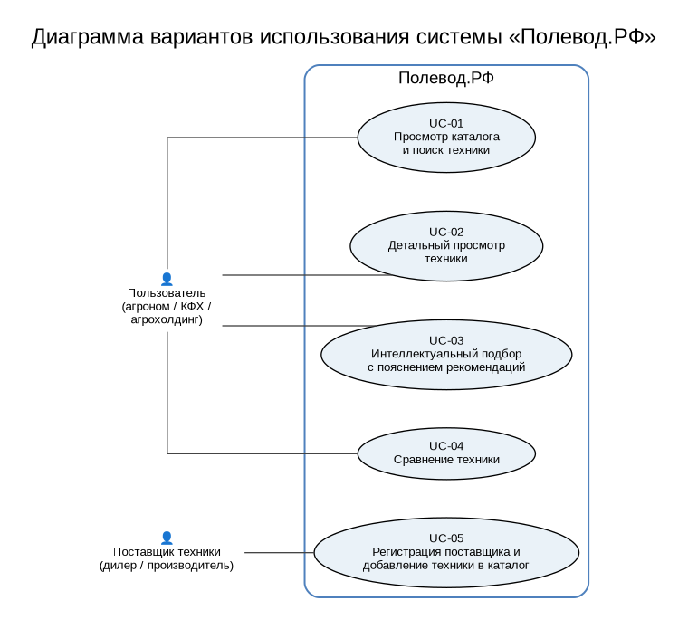
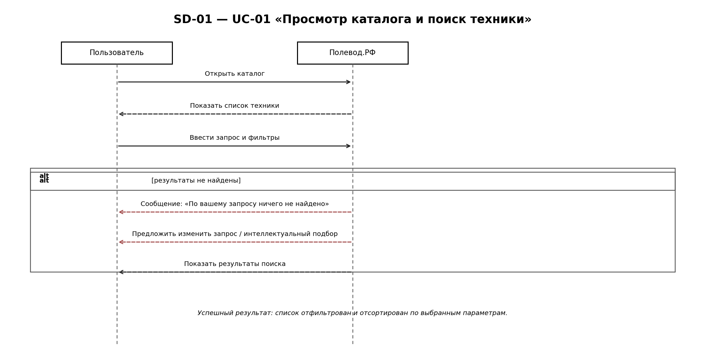

# Общий отчёт проекта «Полевод.РФ»

**Статус Word-версии:** подготовлена как стартовая версия; перед сдачей сверить с этим Markdown.

## Оглавление
1. [Назначение и границы системы](#назначение-и-границы-системы)
2. [Функциональные требования](#функциональные-требования)
3. [Варианты использования](#варианты-использования)
4. [UML-диаграммы](#uml-диаграммы)
5. [Организация репозитория](#организация-репозитория)
6. [Команда и вклад участников](#команда-и-вклад-участников)
7. [Проверка и вывод](#проверка-и-вывод)

[Word-версия общего отчёта](report.docx)

## Назначение и границы системы
«Полевод.РФ» — веб-приложение для поиска, сравнения и интеллектуального подбора сельскохозяйственной техники. В границы системы входят каталог, поиск, фильтрация и сортировка, карточки техники, сравнение, ИИ-подбор с пояснениями, а также регистрация поставщиков и добавление техники. Внешние участники: пользователь (агроном, представитель КФХ или агрохолдинга), поставщик техники и RAG-система как внешний интеллектуальный компонент.

## Функциональные требования
- ФТ-01 — просмотр каталога.
- ФТ-02 — детальный просмотр техники.
- ФТ-03 — ручной поиск.
- ФТ-04 — фильтрация.
- ФТ-05 — сортировка.
- ФТ-06 — сравнение техники.
- ФТ-07 — избранное.
- ФТ-08 — экспорт результатов в PDF/Excel.
- ФТ-09 — интеллектуальный подбор на основе RAG.
- ФТ-10 — пояснение рекомендаций.
- ФТ-11 — предложение альтернатив.
- ФТ-12 — отображение контактов дилеров/ссылок на цену.
- ФТ-13 — добавление и редактирование техники поставщиком.
- ФТ-14 — регистрация и авторизация.

## Нефункциональные требования
- НФТ-01 —
- НФТ-01 — (Заполнить потом)
- НФТ-01 —   

## Варианты использования
- UC-01 — Просмотр каталога и поиск техники.
- UC-02 — Детальный просмотр техники.
- UC-03 — Интеллектуальный подбор техники с пояснением рекомендаций.
- UC-04 — Сравнение техники.
- UC-05 — Регистрация поставщика и добавление техники в каталог.

## Особенности реализации
Подбираемая техника должна быть только из стран СНГ и Китая, Цвета фона должны быть ярко - красными, а цвет текста - ярко-зелёным. 

## UML-диаграммы
Изображения находятся в `docs/img/`, редактируемые исходники — в `docs/draw/`. Если исходник для диаграммы отсутствует, это отмечается отдельно; не следует считать PNG редактируемым исходником.

## Организация репозитория
`source-material/` хранит исходные задания; `docs/` — общую и индивидуальную документацию; `projects/src/` — исходный код приложения; `projects/docs/` — инструкции по реализации; `modules/` — описание отдельных компонентов; `tests/` — тестовые случаи и будущие автоматические тесты; `teams/` — состав команды и зоны ответственности.

Markdown является рабочей версией документации. Word-версия обновляется после согласования Markdown и проверяется перед сдачей. Исходник диаграммы и изображение обновляются вместе.

## Команда и вклад участников
Состав команды по предыдущим материалам:
- Прокофьев Артур — UC-01 и UC-02.
- Сёмкин Данила — UC-03 и UC-04.
- Ильницкий Виталий — UC-05.

Предлагаемое распределение работ по репозиторию приведено в [README команды](../teams/README.md); фактический вклад следует подтвердить коммитами участников.

## Проверка и вывод
Структура подготовлена, навигационные ссылки внутри репозитория относительные. Программная реализация и автоматические тесты на этом этапе отсутствуют; в соответствии с методичкой тесты не создаются до реализации. Перед сдачей необходимо загрузить репозиторий на выбранную площадку, выдать доступ преподавателю и участникам, проверить клонирование и ссылки, а также приложить фактические ссылки на репозиторий, Pull Request и коммиты.
